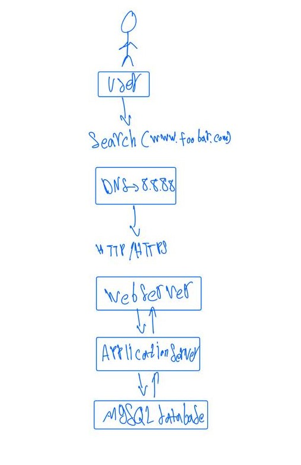
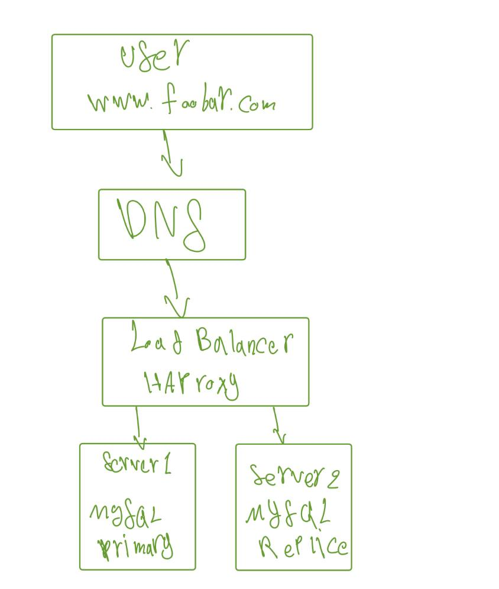
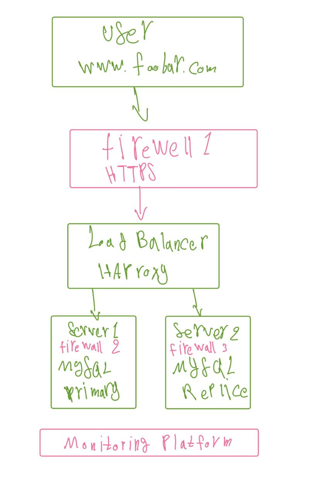
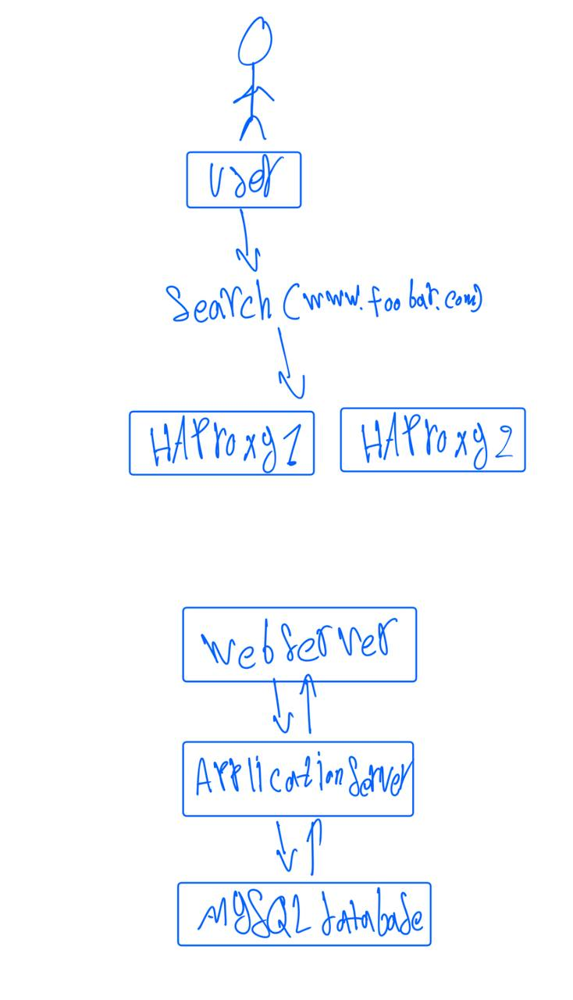

# Web Infrastructure Design

## Task 0: Simple Web Stack

### Diagram

### Explanations

- **Server:** A computer that provides services to other computers.
- **Domain name:** A human-readable address for the website.
- **DNS record:** An A record maps `www.foobar.com` to `8.8.8.8`.
- **Web server (Nginx):** Receives HTTP/HTTPS requests and serves static files.
- **Application server:** Runs the application code.
- **Database (MySQL):** Stores and manages data.
- **Communication:** HTTP or HTTPS connects the browser to the server.

### Issues

- **SPOF:** If the server fails, the website becomes unavailable.
- **Downtime:** Maintenance may temporarily interrupt the website.
- **Scalability:** One server has limited resources.

---

## Task 1: Distributed Web Infrastructure

### Diagram

### Explanations

- **HAProxy:** Distributes requests between two servers using Round Robin.
- **Active-Active:** Both application servers handle requests simultaneously.
- **Database replication:** The Primary handles writes, and the Replica receives replicated data.
- **Second server:** Improves capacity and allows traffic to continue if one application server fails.

### Issues

- **SPOF:** The single load balancer can fail.
- **Security:** No firewall or HTTPS leaves the infrastructure vulnerable.
- **Monitoring:** Without monitoring, failures may go undetected.

---

## Task 2: Secured and Monitored Web Infrastructure

### Diagram

### Explanations

- **Three firewalls:** Restrict unauthorized network traffic.
- **SSL/TLS certificate:** Enables HTTPS and encrypts browser communication.
- **Three monitoring clients:** Collect logs and metrics from the load balancer and two servers.
- **Monitoring platform:** Analyzes data and helps detect problems.
- **QPS/RPS monitoring:** Measures requests handled per second using server metrics or access logs.

### Issues

- **SSL termination:** Backend traffic is unencrypted if HTTP is used after the load balancer.
- **Single Primary database:** Write operations may stop if the Primary fails.
- **Identical components:** Sharing resources between the database, web server, and application server can complicate scaling and maintenance.

---

## Task 3: Scale Up

### Diagram

### Explanations

- **Second HAProxy:** Provides load-balancer redundancy through a cluster and failover mechanism.
- **Dedicated web server:** Handles web requests and static content.
- **Dedicated application server:** Executes application logic.
- **Dedicated database server:** Stores application data separately.
- **Scaling:** Separating components allows independent maintenance and resource upgrades.

### Issues

- Dedicated servers can still become single points of failure.
- Additional redundancy and monitoring may be needed to improve availability.

